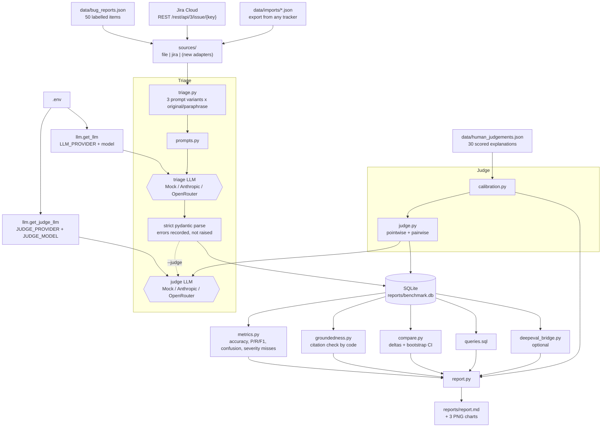
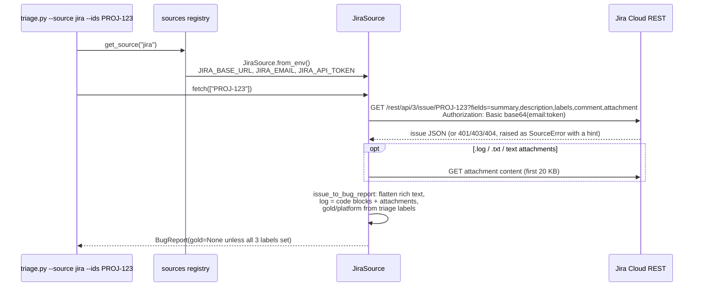
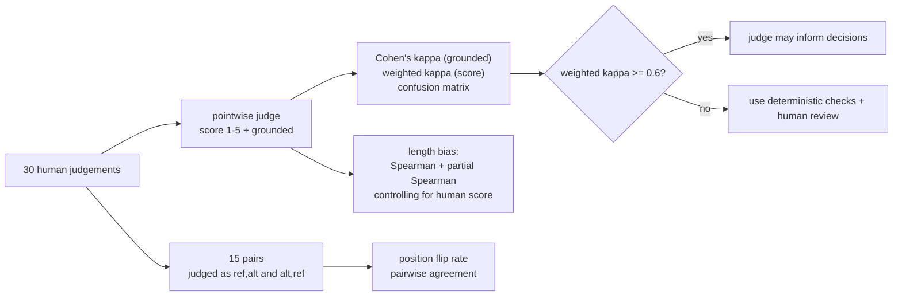
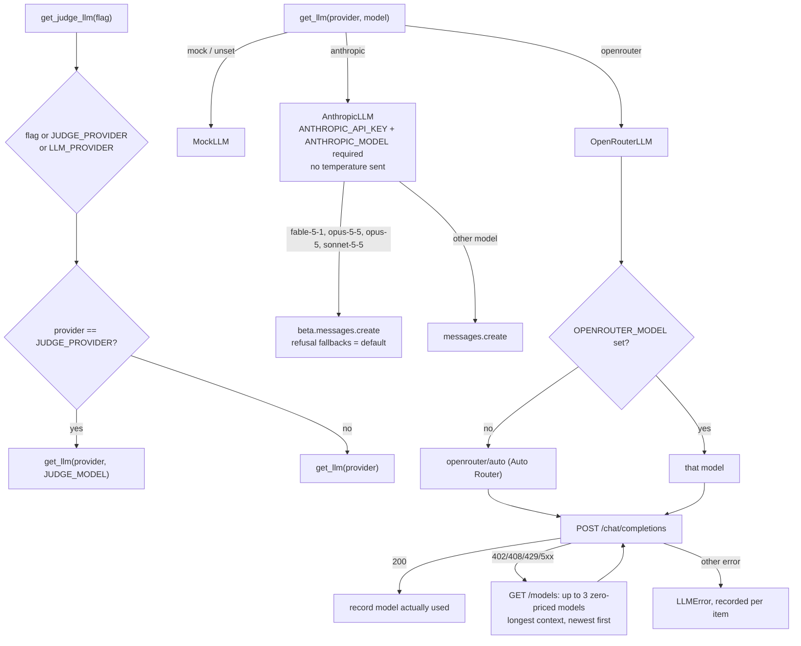
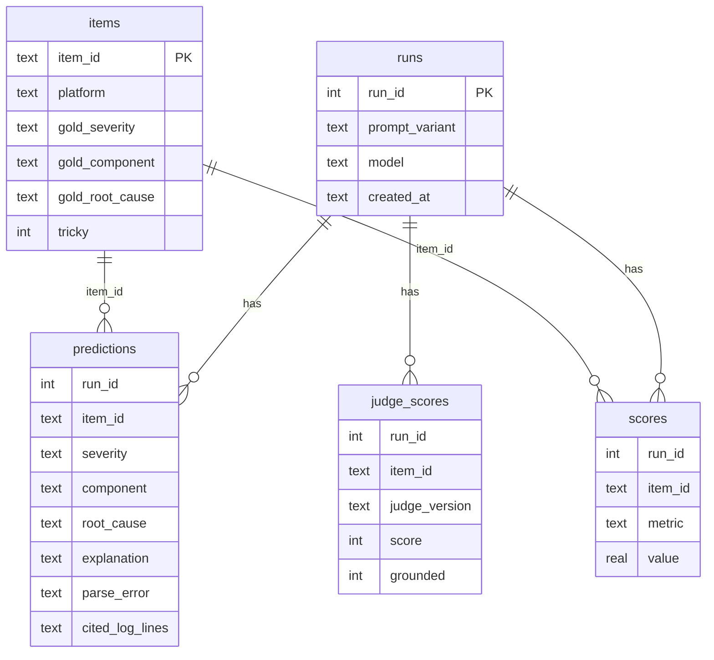

# Bug Triage – Architecture

## 1. End-to-end pipeline (`run_all.py`)



## 2. Modules

| Module | Responsibility | Depends on |
|---|---|---|
| `schemas.py` | Pydantic models (`BugReport`, `Label`, `TriageOutput`, `TriageResult`, `JudgeScore`, `PairwiseVerdict`, `HumanJudgement`), label vocabularies, data loaders, paths. `BugReport.gold` is optional, so tracker tickets need no answer key. | pydantic |
| `sources/base.py` | `BugSource` protocol (`name`, `fetch(ids)`), `SourceError`, and `parse_triage_labels`, the tracker-neutral label convention for gold and platform | schemas |
| `sources/file_source.py` | JSON file source (benchmark set or any export), optional id filter | schemas |
| `sources/jira_source.py` | Jira Cloud REST source: issue → `BugReport`, rich-text flattening, log from code blocks and text attachments | urllib, base64, python-dotenv |
| `sources/__init__.py` | `SOURCES` registry and `get_source(name)`; the only place a new tracker is registered | sources |
| `prompts.py` | Triage prompts `v1_basic`, `v2_structured`, `v3_cot_light`; judge prompts `judge_v1`, `judge_v2`, `judge_v2_reworded`; pairwise `v1`/`v2`. Every prompt starts with `### prompt_id:` and fences untrusted text in `<<<NAME … NAME>>>` | schemas |
| `llm.py` | `LLM` protocol, `MockLLM` simulator, `AnthropicLLM`, `OpenRouterLLM`, `get_llm` (triage) and `get_judge_llm` (judge) factories, `strip_code_fence` | groundedness, anthropic (lazy), urllib |
| `triage.py` | Fetches reports from a source, builds prompts, calls the triage LLM, parses strictly, paraphrase transform, optional `--judge` scoring, stores the run, CLI | sources, llm, prompts, judge, store, metrics |
| `metrics.py` | Per-field accuracy, per-class P/R/F1, macro-F1, confusion matrix, severity misses, tricky split, label flips | scikit-learn, pandas |
| `groundedness.py` | Whitespace-normalised exact match of cited lines against the log | pydantic |
| `judge.py` | Pointwise score / grounded flag and pairwise winner, parsed strictly. `score_explanation` also returns why a score is missing (provider error or invalid reply) | llm, prompts |
| `calibration.py` | Cohen's kappa, quadratic-weighted kappa, confusion, position bias, partial-Spearman length bias, trust rule, CLI | scikit-learn, numpy, pandas |
| `store.py` | SQLite schema and save/load helpers | sqlite3 |
| `compare.py` | Two-run comparison, paired bootstrap CI, recommendation rule, CLI | numpy, store, metrics |
| `report.py` | Markdown report, SQL query results, matplotlib charts | all of the above |
| `deepeval_bridge.py` | Citation check as a DeepEval `BaseMetric`; GEval judge via a `DeepEvalBaseLLM` adapter (real providers only) | deepeval (optional) |

## 3. Bug-source ingestion (Jira example)



Adding a tracker means a new class in `src/sources/` that returns `BugReport`s, plus one entry in `SOURCES`. Nothing downstream changes.

## 4. Triage run sequence

```mermaid
sequenceDiagram
    participant CLI as triage.py
    participant P as prompts.py
    participant L as LLM
    participant V as pydantic
    participant DB as store.py
    CLI->>CLI: fetch + validate BugReports from the source
    loop each item
        CLI->>P: triage_prompt(variant, item[, paraphrased description])
        P-->>CLI: prompt with fenced DESCRIPTION / LOG
        CLI->>L: complete(prompt)
        alt provider error (LLMError)
            CLI->>CLI: record parse_error "llm error: ..."
        else reply
            CLI->>V: TriageOutput.model_validate_json(strip_code_fence(reply))
            V-->>CLI: output or validation error (recorded)
        end
    end
    opt --judge
        CLI->>L: judge LLM scores each explanation (judge_v2)<br/>log only; tracker tickets also send the description
        L-->>CLI: score, or the failure reason (printed)
    end
    CLI->>DB: save run, predictions, per-item scores<br/>(correct flags only when gold exists, citation counts,<br/>parse_error, judge_score / judge_grounded)
```

## 5. Judge calibration flow



`judge_v2_reworded` reuses the v2 intent with different wording, to measure the judge's own prompt sensitivity.

## 6. Provider selection

**Triage vs judge:**
- `get_llm(provider, model)` builds the triage model from `LLM_PROVIDER` and `ANTHROPIC_MODEL` / `OPENROUTER_MODEL`.
- `get_judge_llm(provider)` resolves the provider from the CLI flag, then `JUDGE_PROVIDER`, then `LLM_PROVIDER`.
- It applies `JUDGE_MODEL` only when the chosen provider equals `JUDGE_PROVIDER`.
- `run_all.py` forces a mock judge when the triage provider is mock, so the offline run stays free.



## 7. Data model (SQLite)



Score metrics per triage item:
- `severity_correct`, `component_correct`, `root_cause_correct` (only when the item has gold)
- `parse_error`
- `citations_total`, `citations_invalid`
- `judge_score`, `judge_grounded` (with `--judge`)

Tracker items are stored in `items` with null gold columns, and their runs are labelled `<variant>@<source>`.

Per judged pair: `pairwise_flip` and `pairwise_agree`.

The spec's four tables are kept. The `items` table and the `cited_log_lines` column were added because the SQL queries need gold labels and platform, and the report rebuilds runs from the database.

## 8. MockLLM design

The mock is a **scripted simulator**, documented as such everywhere its numbers appear.

- **Triage:**
  - Reads the gold label, then decides "wrong or right" per field with `sha256(item, variant, field)`.
  - Error rates: v1 0.22, v2 0.12, v3 0.06, plus 0.25 / 0.18 / 0.12 on tricky items.
  - A second hash, which includes the description, gives paraphrase sensitivity: 0.12 / 0.06 / 0.03.
  - Hallucinated-citation rates are 0.20 / 0.10 / 0.04, and parse-error rates 0.06 / 0.02 / 0.
  - v1 always guesses a cause when gold is `unknown`, and obeys a prompt injection placed on the last log line.
- **judge_v1:** scores by explanation length, and prefers option A unless B is more than 1.6× longer. This produces length and position bias.
- **judge_v2:** a rubric heuristic that verifies quotes against the log, penalises missing evidence and vague text, and checks the claimed cause's keywords against the log. It accepts "Insufficient information" for empty logs. `judge_v2_reworded` uses slightly different penalties.

## 9. Design decisions

| Decision | Reason |
|---|---|
| Bug sources behind one `BugSource` interface | Any tracker plugs in without touching triage, metrics or storage |
| Jira over REST, not MCP, inside the app | The Python app cannot reach the Claude Code MCP connection; REST is direct and has no extra dependency. MCP stays useful for exporting tickets in a Claude Code session. |
| Gold labels only from explicit triage labels | No guessing severity from priority; a missing label means "not scored" |
| Separate judge model | A model should not grade its own answers; the judge can be stronger or from another family |
| Citations checked by code, not by a judge | Exact-match facts should not depend on an LLM's opinion |
| Strict parsing, errors recorded | Real model output is messy; a parse failure is a measured outcome, not a crash |
| Severity misses reported separately | Accuracy hides the costly error |
| Recommendation requires CI > 0 **and** no new severity misses | Small samples and asymmetric error cost |
| Paired bootstrap (2000, seed 42) | Honest uncertainty with 50 items, reproducible |
| Quadratic-weighted kappa for scores | Near-miss scores (4 vs 5) should cost less than far misses |
| Prompt ids in the prompt header | Lets the mock route deterministically, and keeps prompts versioned |
| No hard-coded model ids | Model names go stale; the user sets them in `.env` |
